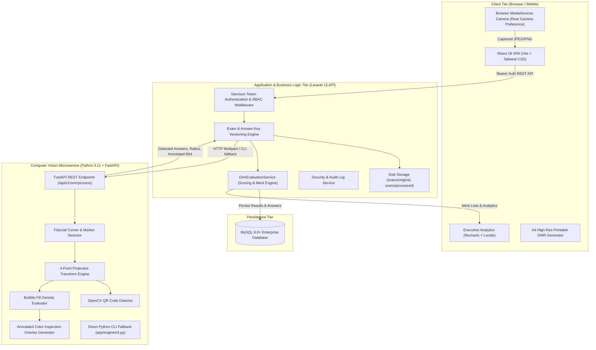
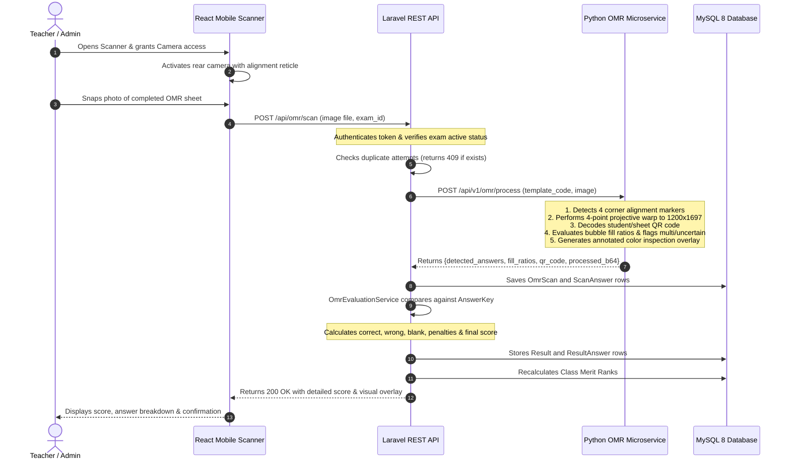

# SmartOMR System Architecture & Technical Specification

## 1. System Overview

**SmartOMR** is an enterprise-grade automated optical mark recognition (OMR) examination management and evaluation platform. It streamlines the full lifecycle of physical multiple-choice examinations: from template layout authoring and printable A4 PDF sheet generation, to mobile web-browser camera scanning, perspective-warped computer vision recognition, automated penalty-aware scoring, teacher audit reviews, and instant student merit list publication.

### Architectural Philosophy
- **Separation of Concerns:** Python is strictly scoped to high-performance computer vision, OpenCV matrix transformations, and numerical image analysis. Laravel 12 owns 100% of the relational data, application business logic, RBAC security, audit trails, and result calculations.
- **Hardware-Agnostic Scanning:** Works on standard commodity smartphones running Chrome or Safari via the HTML5 W3C MediaDevices (`getUserMedia`) API without requiring native iOS or Android app downloads.
- **Fail-Safe Processing Pipeline:** The system provides microsecond HTTP microservice processing with an integrated zero-downtime Python CLI fallback mechanism if the FastAPI daemon is offline.
- **Deterministic Coordinate Geometry:** OMR templates use normalized canonical grids ($1200 \times 1697$ resolution) anchored to four high-contrast fiducial markers.

---

## 2. High-Level Component Architecture

---

## 3. End-to-End Scan & Evaluation Sequence

---

## 4. Computer Vision & Mathematical Recognition Model

### 4.1. Coordinate System & Canonical Space
All examinations conform to standardized geometric layouts normalized to an A4 aspect ratio ($1:\sqrt{2}$) on a canonical coordinate canvas of:
$$\text{Width} = 1200\,\text{px}, \quad \text{Height} = 1697\,\text{px}$$

### 4.2. Fiducial Corner Detection & Perspective Rectification
Every OMR sheet features four solid black alignment square markers ($40 \times 40\,\text{px}$) positioned at the four corners.
The vision engine localizes each marker center $(c_x, c_y)$ inside quadrant bounding boxes via Otsu binarization and spatial contour moment analysis:
$$c_x = \frac{M_{10}}{M_{00}} + x_{\text{offset}}, \quad c_y = \frac{M_{01}}{M_{00}} + y_{\text{offset}}$$

The detected four points $P = [p_1, p_2, p_3, p_4]$ are ordered into $[\text{Top-Left}, \text{Top-Right}, \text{Bottom-Right}, \text{Bottom-Left}]$ and mapped to canonical destination fiducial targets:
$$D = \begin{bmatrix} 70 & 70 \\ 1130 & 70 \\ 1130 & 1627 \\ 70 & 1627 \end{bmatrix}$$

The $3 \times 3$ projective perspective transformation matrix $M$ is solved such that:
$$t_i \begin{bmatrix} x_i' \\ y_i' \\ 1 \end{bmatrix} = M \begin{bmatrix} x_i \\ y_i \\ 1 \end{bmatrix}$$
where $(x_i, y_i)$ are points in $P$, and $(x_i', y_i')$ are points in $D$.
The rectified image $I_{\text{rectified}}$ is produced via bilinear interpolation:
$$I_{\text{rectified}} = \text{warpPerspective}(I_{\text{orig}}, M, (1200, 1697))$$

### 4.3. Bubble Density & Fill Ratio Formulation
For each question $q \in [1, N]$ and option $o \in \{A, B, C, D\}$, canonical coordinates $(c_x, c_y)$ and bubble radius $r = 18\,\text{px}$ are queried from the template layout.
A circular sampling mask $\Omega(c_x, c_y, r - 3)$ of radius $r - 3$ is applied to eliminate perimeter printing borders:
$$\Omega = \{(x, y) \mid (x - c_x)^2 + (y - c_y)^2 \le (r - 3)^2\}$$

The fill ratio $\Phi(q, o)$ is calculated as the ratio of dark pixels to the total mask area:
$$\Phi(q, o) = \frac{1}{|\Omega|} \sum_{(x, y) \in \Omega} \mathbb{I}\left(I_{\text{bin}}(x, y) == 0\right)$$
where $I_{\text{bin}}$ is the adaptive thresholded grayscale canvas.

### 4.4. Decision Boundaries & Quality Flags
- **Filled Bubble Condition:** $\Phi(q, o) \ge 0.42$
- **Blank Bubble Condition:** $\Phi(q, o) \le 0.22$
- **Multiple Mark Detection:**
  If $|\{o \mid \Phi(q, o) \ge 0.38\}| > 1$, question $q$ is flagged as `multiple` and marked invalid ($0.00$ marks, or penalty if configured).
- **Uncertain Mark Detection:**
  Let $\Phi_{(1)}$ and $\Phi_{(2)}$ be the highest and second-highest fill ratios. If:
  $$\Phi_{(1)} \ge 0.28 \quad \text{and} \quad (\Phi_{(1)} - \Phi_{(2)}) < 0.12$$
  the question is flagged as `uncertain` and scheduled for Teacher Manual Review.

### 4.5. Color Inspection Overlay
The engine renders a high-resolution BGR visual feedback image:
- **Green circle & solid dot:** Single detected valid marked answer.
- **Red circle & exclamation mark:** Multiple marked invalid bubble.
- **Yellow dotted circle:** Uncertain marking requiring human verification.
- **Subtle cyan guide:** Blank unselected bubbles.

---

## 5. Scoring & Merit List Engine (Laravel)

### 5.1. Score Calculation Formula
Given an exam configuration with:
- Correct answer mark weight: $W_+$
- Wrong answer penalty: $W_-$
- Passing threshold: $T_{\text{pass}}$

For each student's scan:
$$\text{Score}_{\text{raw}} = \sum_{q=1}^{N} \mathbb{I}(A_q == K_q) \cdot W_+$$
$$\text{Penalty} = \sum_{q=1}^{N} \mathbb{I}(A_q \ne \emptyset \land A_q \ne K_q) \cdot W_-$$
$$\text{Score}_{\text{final}} = \max(0, \text{Score}_{\text{raw}} - \text{Penalty})$$
$$\text{Percentage} = \frac{\text{Score}_{\text{final}}}{N \cdot W_+} \times 100$$
$$\text{Status} = \begin{cases} \text{Passed}, & \text{Score}_{\text{final}} \ge T_{\text{pass}} \\ \text{Failed}, & \text{Score}_{\text{final}} < T_{\text{pass}} \end{cases}$$

### 5.2. Deterministic Tie-Breaking Merit Algorithm
Merit ranks are ordered dynamically across the examination cohort using a strict multi-tier hierarchy:
1. **Primary:** Final Score ($\text{Score}_{\text{final}}$) descending.
2. **Secondary:** Fewest wrong answers ($N_{\text{wrong}}$) ascending.
3. **Tertiary:** Fewest blank questions ($N_{\text{blank}}$) ascending.
4. **Quaternary:** Student Registration Number alphabetically ascending.

---

## 6. Security, RBAC & Storage Architecture

### 6.1. Role-Based Access Control Matrix
| Feature / Action | Super Admin | Teacher | Student |
|---|:---:|:---:|:---:|
| User Management (Admins & Teachers) | ✅ | ❌ | ❌ |
| Academic Hierarchy (Classes, Batches, Sections) | ✅ | ✅ (Read) | ❌ |
| Create & Edit Examinations | ✅ | ✅ | ❌ |
| Configure & Edit Answer Keys | ✅ | ✅ | ❌ |
| Download & Print OMR Sheets | ✅ | ✅ | ❌ |
| Perform Mobile Camera OMR Scanning | ✅ | ✅ | ❌ |
| Manual Review & Correction of Uncertain Scans | ✅ | ✅ | ❌ |
| Finalize & Publish Merit Results | ✅ | ✅ | ❌ |
| View System Dashboard Analytics | ✅ | ✅ (Cohort) | ❌ |
| View Student Portal Published Results | ✅ | ✅ | ✅ (Own Only) |

### 6.2. W3C MediaDevices Camera Security Constraints
Modern mobile browsers (Chrome, Safari, Firefox) enforce strict security policies regarding camera hardware access:
- **HTTPS Transport Layer:** The browser camera API (`navigator.mediaDevices.getUserMedia`) is **disabled** on insecure origins. Production deployments must terminate TLS with valid certificates.
- **Localhost Exception:** For development and local testing, modern browsers treat `http://localhost` and `http://127.0.0.1` as secure origins.
- **Hardware Fallback:** When camera hardware is blocked, not permitted, or unavailable (e.g. desktop environments without webcams), the UI automatically provides a drag-and-drop high-resolution file picker fallback.

### 6.3. Privacy-Preserving OMR Sheets & QR Identifiers
Every generated OMR sheet features an encrypted, non-guessable sheet identifier:
$$\text{sheet\_uid} = \text{SH-}[\text{A-Z0-9}]_{16}\text{-}[\text{timestamp}]$$
- The printed QR code encapsulates **only** this non-guessable `sheet_uid`.
- No sensitive student personal information (phone numbers, addresses, emails) is ever encoded into the physical sheet QR code.
- During scanning, the vision engine reads the QR code and resolves the student and examination records securely inside the private database layer.

